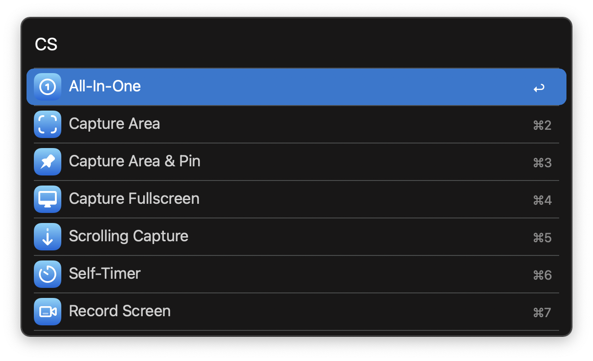
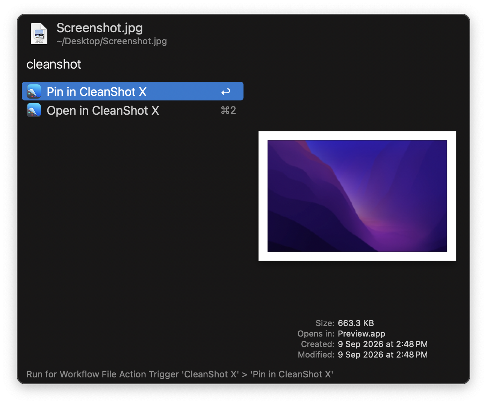

#  CleanShot X Alfred Workflow

Control [CleanShot X](https://cleanshot.com) with Alfred

[⤓ Download the workflow](https://github.com/iAli/cleanshot-x-workflow/releases/latest)

## Setup

Enable api integration in: CleanShot X Settings → Advanced → API.

## Usage

Trigger CleanShot X commands via the `cs` keyword.

Pin or Annotate an image in CleanShot X via the Universal Action.

